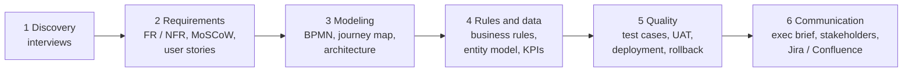
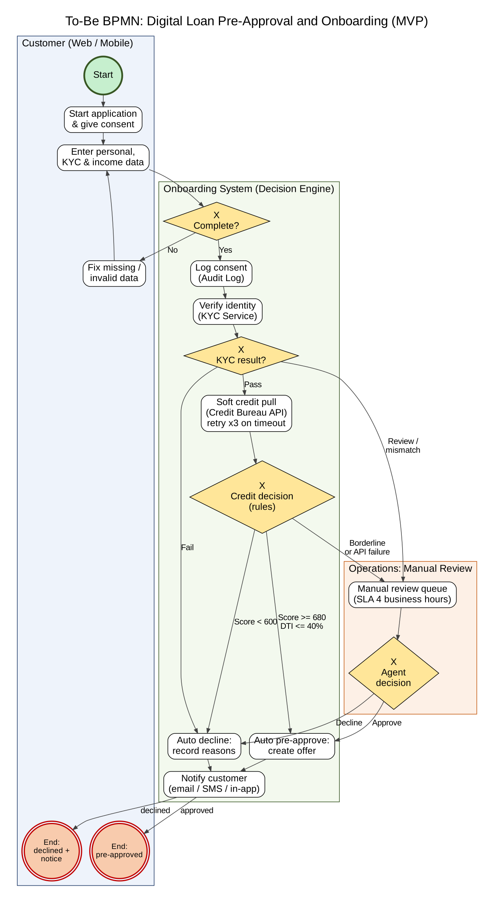
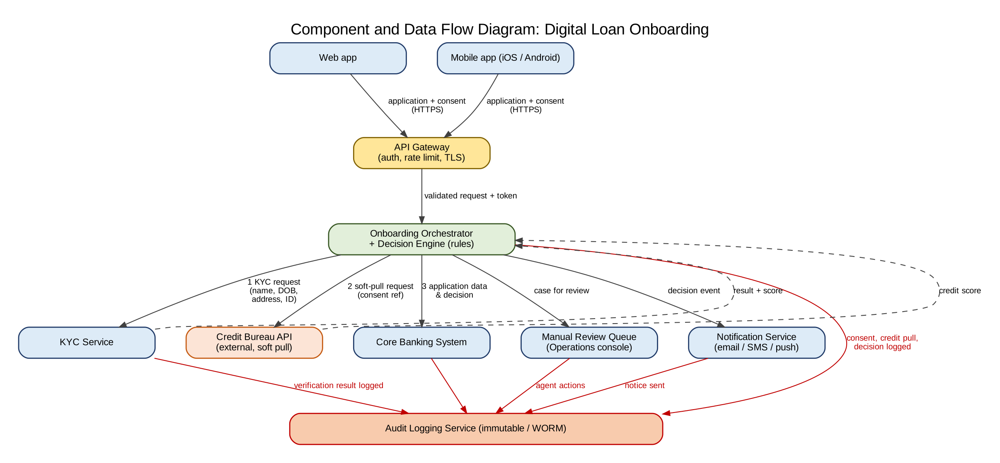
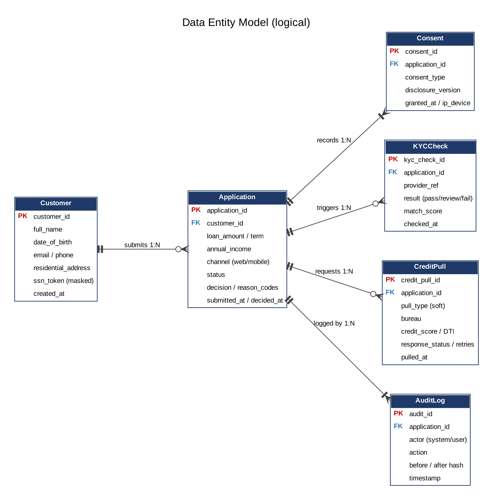
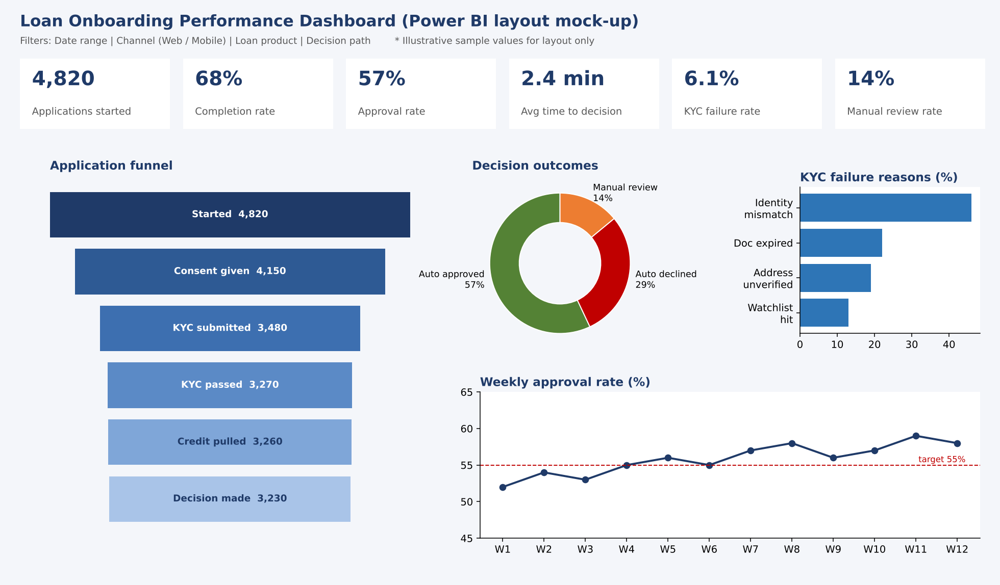

# Digital Loan Pre-Approval & Onboarding: Business Analysis Case Study

> End-to-end business and systems analysis for a fictional online bank launching an automated digital loan pre-approval and onboarding system (MVP). The work covers discovery, requirements, process and architecture modeling, business rules and data design, testing and deployment readiness, and stakeholder communication, with generative AI used throughout under human review.

**Role:** Business / Systems Analyst · **Type:** Portfolio case study (fictional scenario) · **Author:** Devina Dewi Faustina Basam

---

## The business problem

Loan applicants face long forms, slow manual checks and days of waiting for an answer. Many abandon the process, cost per application stays high, and inconsistent manual steps create compliance risk.

**Goal:** a web and mobile flow that captures consent and KYC data, runs a **soft credit pull** (no impact on the customer's credit score), and returns a **pre-approval decision within minutes**. Complex cases go to human agents, and every step is audit-logged.

| Target outcome       | Metric                                                               |
| -------------------- | -------------------------------------------------------------------- |
| Fast decisions       | Under 3 minutes for 95% of automated applications                    |
| Higher conversion    | Application completion rate of at least 60%                          |
| Efficient operations | At least 85% auto-decided; manual review under 15% with a 4-hour SLA |
| Compliance           | 100% of consents and decisions audit-logged                          |

**MVP scope:** consent capture, KYC/identity verification, soft credit pull, rules-based decision engine, manual review queue, notifications, audit logging.
**Out of scope:** multilingual UI, document upload, cross-sell, joint applications, automated funding.

---

## Approach



Every artifact is traceable: **user story → business rule → test case → Jira story** (e.g., US-06 → BR-05 → TC-01/TC-05 → LOAN-103).

---

## Key artifacts

### To-be process (BPMN)

Three lanes (Customer, Onboarding System, Operations) with gateways for data completeness, KYC result, credit decision and agent decision.



### Component and data flow



### Data entity model



### KPI dashboard (Power BI layout mock-up, illustrative values)



All diagrams are also available as **Mermaid code** that GitHub renders directly: see [`diagrams/mermaid`](diagrams/mermaid/README.md).

---

## Key decisions and trade-offs

| Decision                                                                                 | Why                                                                                                    |
| ---------------------------------------------------------------------------------------- | ------------------------------------------------------------------------------------------------------ |
| **API failures never auto-decline** (retry 3x with backoff, then route to manual review) | A system error must not cost a good customer a loan or trigger an incorrect adverse-action notice      |
| **KYC partial match goes to manual review**, not decline                                 | Avoids rejecting real customers because of data-entry differences, while keeping identity rules strict |
| **Consent is checked before every credit pull**                                          | The soft pull is only allowed with recorded consent; consent is versioned and audit-logged             |
| **The 3-minute target applies to automated decisions only**                              | Resolved a conflict between Product (speed) and Operations (4-hour review SLA)                         |
| **Decision rules use only credit-related factors**, with reason codes                    | Supports fair-lending review and explainable adverse-action notices                                    |
| **Audit log is append-only and tamper-evident**                                          | Needed to prove compliance in audits                                                                   |

---

## Documents

| #   | Document                                                                        | Contents                                                                                            |
| --- | ------------------------------------------------------------------------------- | --------------------------------------------------------------------------------------------------- |
| 01  | [Discovery and Requirements](docs/01-discovery-and-requirements.pdf)            | Interview plan, simulated interviews and gaps, FR/NFR, MoSCoW, 10 user stories with Given/When/Then |
| 02  | [Process and Architecture](docs/02-process-and-architecture.pdf)                | To-be BPMN, customer journey map, component and data flow diagram                                   |
| 03  | [Rules, Data and Insights](docs/03-rules-data-insights.pdf)                     | 10 business rules (IF/THEN), entity model, 8 KPIs, dashboard layout                                 |
| 04  | [Quality, Deployment and Compliance](docs/04-quality-deployment-compliance.pdf) | 9 Gherkin test cases, UAT plan, deployment and rollback checklists, compliance/performance brief    |
| 05  | [Communication and Platform Stubs](docs/05-communication-platform-stubs.pdf)    | Executive brief (EN + ES), stakeholder map, RACI, Jira epic and stories, Confluence outline         |
| 06  | [AI Usage Reflection](docs/06-ai-usage-reflection.pdf)                          | How AI was used, verification steps, ethics and limitations                                         |

---

## Tools

Generative AI (Claude) for drafting · Graphviz and Mermaid (diagrams as code) · Python / matplotlib (mock-ups) · Microsoft Word · Jira / Confluence / Power BI (designed as stubs and layouts)

## How AI was used

Generative AI was used to draft interview questions, simulate stakeholder interviews, and produce first drafts of requirements, rules, test cases and diagram code. All outputs were reviewed for consistency, traceability and realism before inclusion. Simulated interviews are clearly marked and would be replaced by real stakeholder sessions in a live project. Details are in [06-ai-usage-reflection](docs/06-ai-usage-reflection.pdf).

## Disclaimer

The bank, stakeholders, data and metrics are **fictional**. Credit thresholds, retention periods and regulatory references (FCRA, ECOA/Reg B, BSA/CIP, GLBA, E-SIGN) are assumptions for a US context and are not legal or compliance advice. Developed as a learning project on AI-enhanced business analysis.

## Repository structure

```
.
├── README.md
├── docs/                 # 6 deliverables (PDF)
└── diagrams/
    ├── png/              # rendered images used in this README
    ├── source/           # Graphviz (.dot) and Python sources
    └── mermaid/          # Mermaid versions (rendered by GitHub)
```

To re-render a Graphviz diagram: `dot -Tpng diagrams/source/bpmn-to-be.dot -o diagrams/png/bpmn-to-be.png`
