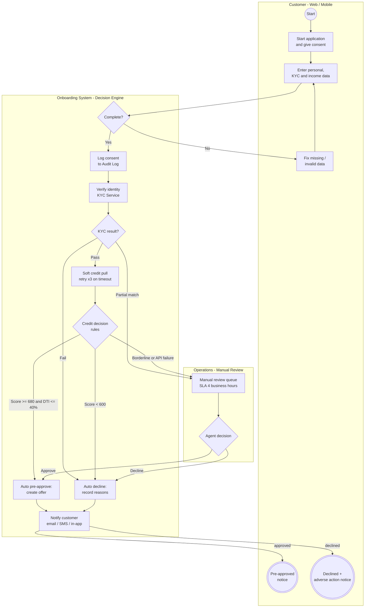
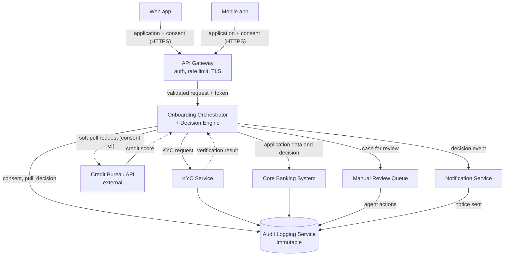
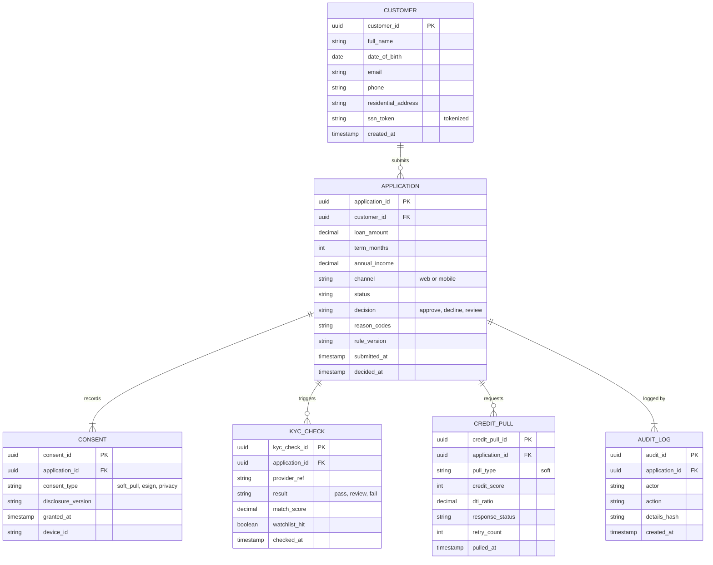

# Diagrams as code (Mermaid)

GitHub renders these diagrams directly. PNG versions (rendered from Graphviz) are in [`../png`](../png), and their sources are in [`../source`](../source).

## 1. To-be process flow (BPMN-style)

## 2. Component and data flow

## 3. Entity model

